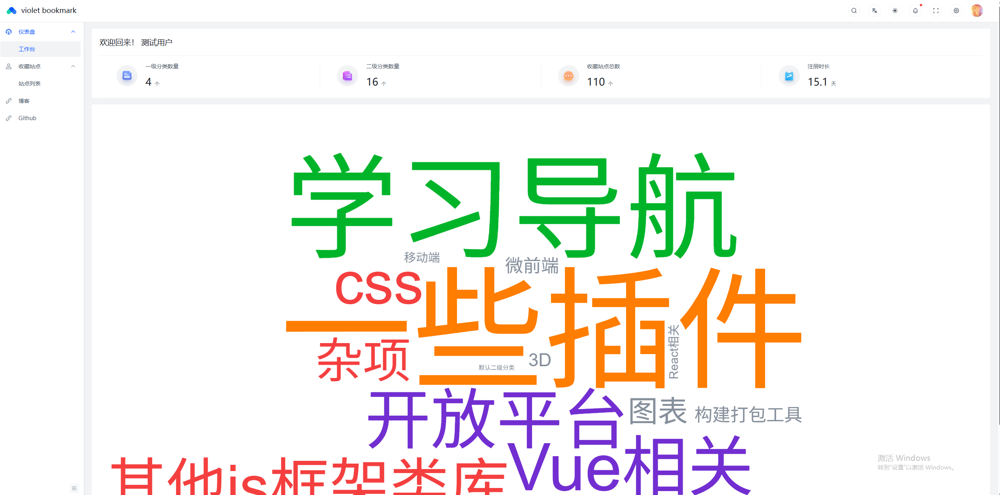
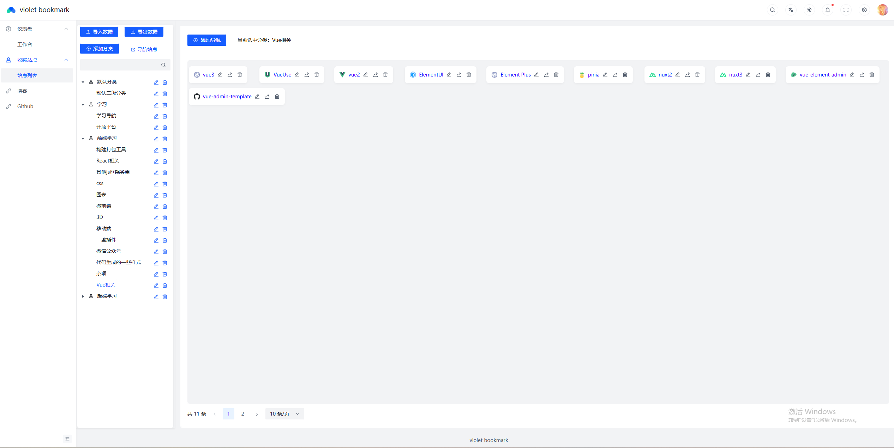
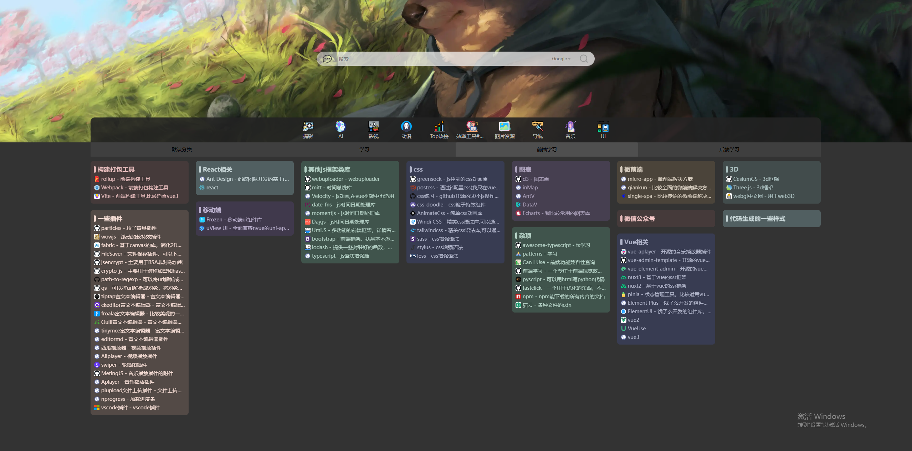

# violet-bookmark 前端

借鉴兰客书签的个人导航书签系统，支持手动添加或 URL 自动解析，便于整理常用站点。

- 在线预览<http://bookmark.carolin-violet.cn:8000/>（直连线上后端）
- 账号：`user` / `12345678`
- 仓库：<https://github.com/carolin-violet/violet-bookmark-frontend>

## 功能概览

- 导航/书签：分类管理、书签详情、URL 自动解析
- 私有书签：增删改查，登录后可用
- 预览体验：公共导航浏览、站点大图/卡片预览
- 仪表盘：基础统计与内容占比展示
- 国际化与主题：中/英、多主题、动效

## 技术栈

- 框架：Vue 3、TypeScript、Vite
- UI：Arco Design Vue、Animate.css
- 状态与路由：Pinia、Vue Router
- 工具：Axios、ECharts、mitt、lodash、vue-i18n
- 工程与质量：ESLint、Prettier、Stylelint、Husky + lint-staged、vue-tsc

## 环境要求

- Node.js >= 18.20.5（推荐 pnpm）

## 快速开始

```bash
git clone https://github.com/carolin-violet/violet-bookmark-frontend.git
cd violet-bookmark-frontend
pnpm install          # 安装依赖
pnpm dev              # 启动开发（使用 config/vite.config.dev.ts）
```

### 常用命令

- `pnpm dev`：本地开发
- `pnpm build`：类型检查 + 生产构建
- `pnpm preview`：预览打包产物
- `pnpm type:check`：仅类型检查
- `pnpm lint-staged`：按 lint-staged 规则格式化/校验暂存区

## 项目结构

```
.
├─ config/              # Vite 配置与插件
├─ src/
│  ├─ api/              # 模块化接口与请求封装
│  ├─ assets/           # 全局样式、静态资源
│  ├─ components/       # 通用组件（导航栏、面包屑、图表等）
│  ├─ directive/        # 自定义指令（权限、滚动等）
│  ├─ hooks/            # 通用 hooks（权限、主题、懒加载等）
│  ├─ layout/           # 布局组件
│  ├─ locale/           # i18n 配置
│  ├─ router/           # 路由与守卫
│  ├─ store/            # Pinia 模块
│  ├─ utils/            # 工具方法、监控与存储封装
│  └─ views/            # 页面（导航、预览、仪表盘、登录等）
├─ deployment/          # Nginx 示例配置
├─ Dockerfile           # 容器化构建示例
└─ public/              # 静态资源
```

## 运行展示





## 部署说明

- 生产构建：`pnpm build`，产物位于 `dist/`
- 预览产物：`pnpm preview --host`
- 可参考 `deployment/nginx.conf` 或 `Dockerfile` 进行部署

## 开发提示

- 项目已启用 Mock，默认从 `src/mock` 注入；对接真实接口时可关闭或替换
- 自定义主题样式：`config/plugin/arcoStyleImport.ts`、`src/assets/style/global.less`

## 待办事项

- [ ] 站点图标自动解析与持久化（避免依赖 Google Favicon API）
- [ ] 前端埋点：点击次数、导航点击统计
- [ ] 图表分析：分类/子分类数量、导航站点数、点击排行
- [ ] 页面视觉优化与细节美化
